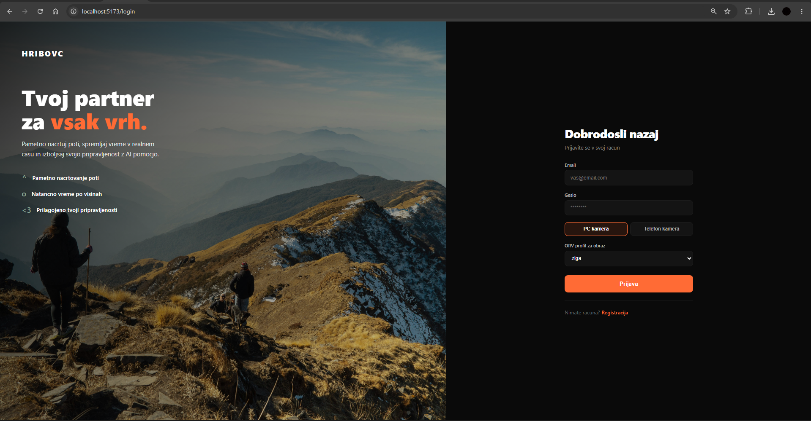
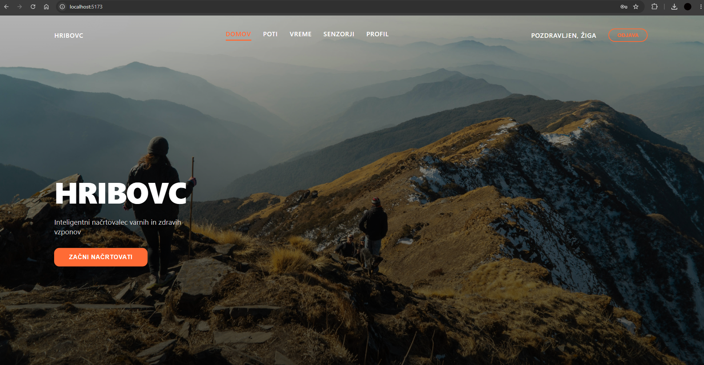
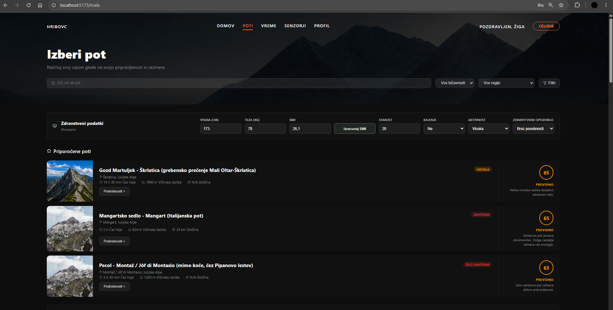
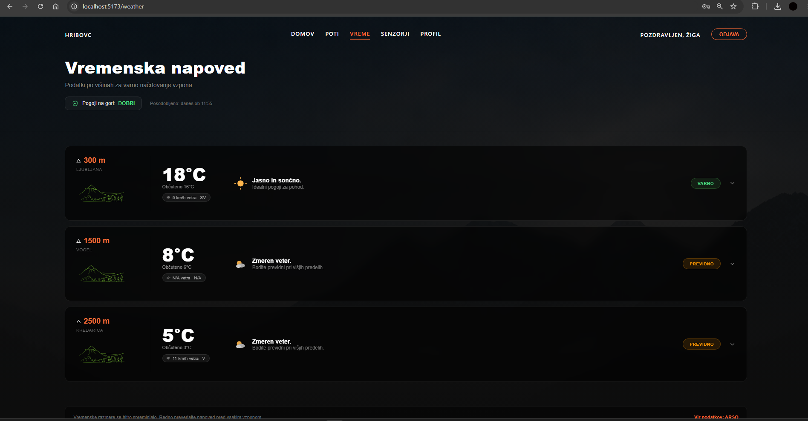
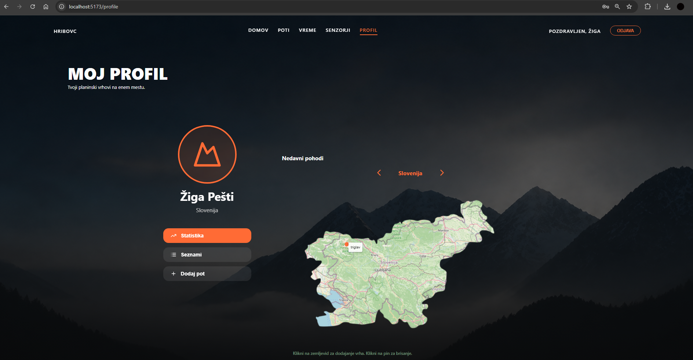
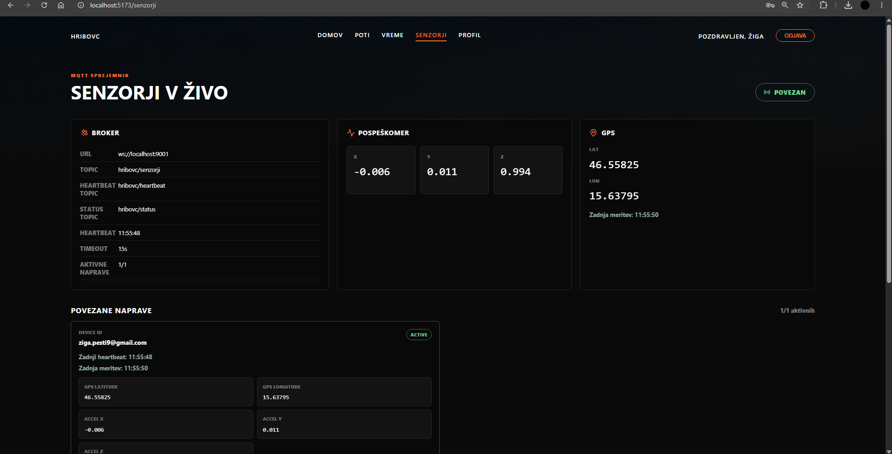
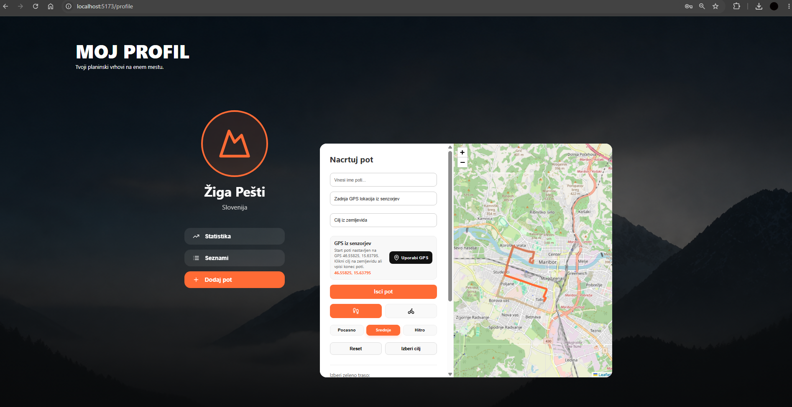

# 🏔️ Hribovc — Integrated Alpine Safety & IoT Telemetry Platform

<p align="left">
  
  
  
  
  
  
  
</p>

> **Hribovc** is an integrated software ecosystem designed for safer hiking and route planning. It combines a modern web portal, an automated meteorological scraping and trail risk analysis backend, biometric face recognition authentication (Computer Vision), and a mobile IoT sensor client streaming real-time accelerometer and GPS data via MQTT.

### 👥 Authors & Team (FERI, University of Maribor)
- **Žiga Pešti** ([@kinderjajckapresenecenja](https://github.com/kinderjajckapresenecenja))
- **Anja Grudnik** ([@anjagrudnik04-max](https://github.com/anjagrudnik04-max))
- **Anže Žunec** ([@AnzeZunec](https://github.com/AnzeZunec))

---

## 🏛️ Arhitektura projekta

Projekt pokriva tri ključne stebre:
1. **Razvoj aplikacij za internet:** Spletna aplikacija (React, Vite, Leaflet interaktivni zemljevidi), REST API zgrajen z Express.js, MongoDB podatkovna baza ter avtomatizirano zajemanje (scraping) vremenskih podatkov in pohodniških poti.
2. **Osnove računalniškega vida:** Biometrično preverjanje uporabnika in 2FA prijava s pomočjo prepoznave obraza (Python, OpenCV, NumPy, Haar Cascades / SVM).
3. **Namenska programska oprema:** Mobilna aplikacija (React Native + Expo) za zajem podatkov pospeškometra in GPS lokacije ter realnočasovni prenos prek MQTT (Eclipse Mosquitto broker) v Docker vsebnikih.

---

## 📸 Predogled spletne aplikacije (Screenshots)

<table width="100%">
  <tr>
    <td width="50%">
      <h4 align="center">🏠 1. Vstopna stran (Domov)</h4>
      
      <p align="center"><i>Predstavitev namena aplikacije in hiter dostop do ključnih funkcij.</i></p>
    </td>
    <td width="50%">
      <h4 align="center">☀️ 2. Vremenske razmere & tveganja</h4>
      
      <p align="center"><i>Razmere in ocena tveganja po nadmorskih višinah (nizko, srednje, visoko gorovje).</i></p>
    </td>
  </tr>
  <tr>
    <td width="50%">
      <h4 align="center">🥾 3. Iskalnik in filtri poti</h4>
      
      <p align="center"><i>Iskanje in filtriranje planinskih poti glede na težavnost, regijo in primernost.</i></p>
    </td>
    <td width="50%">
      <h4 align="center">📊 4. Podrobnosti poti in priporočila</h4>
      
      <p align="center"><i>Podroben profil poti, višinska razlika, čas hoje ter izračunana varnostna ocena.</i></p>
    </td>
  </tr>
  <tr>
    <td width="50%">
      <h4 align="center">🗺️ 5. Interaktivni zemljevid in načrtovanje</h4>
      
      <p align="center"><i>Načrtovanje tras z Leaflet knjižnico, vizualizacija poti in predvideni časi.</i></p>
    </td>
    <td width="50%">
      <h4 align="center">👤 6. Uporabniški profil & osvojeni vrhovi</h4>
      
      <p align="center"><i>Beleženje osvojenih vrhov, zgodovina pohodov in osebne nastavitve.</i></p>
    </td>
  </tr>
  <tr>
    <td colspan="2" align="center">
      <h4>📡 7. Telemetrija senzorjev (MQTT / IoT) & Avtentikacija</h4>
      
      <p align="center"><i>Spremljanje telemetrije mobilnih senzorjev (pospeškometer, GPS) v živo prek MQTT in varna prijava.</i></p>
    </td>
  </tr>
</table>

---

# Hribovc — Navodila za namestitev in zagon

Hribovc je projekt za varnejse nacrtovanje pohodov in vzponov. Zdruzuje spletno aplikacijo, backend z vremenskimi in pohodno-potnimi podatki, modul za prepoznavo obraza ter mobilno aplikacijo za zajem senzorskih podatkov.

## Kaj potrebujete pred zacetkom

Navodila so napisana za uporabnika brez predznanja. Najlazje je, da vse ukaze zaganjate v programu **PowerShell** na Windows racunalniku.

1. Namestite **Node.js LTS** iz strani <https://nodejs.org>.
2. Namestite **MongoDB Community Server** iz strani <https://www.mongodb.com/try/download/community>.
   - Med namestitvijo pustite oznaceno moznost, da se MongoDB zazene kot Windows Service.
   - Ce je vklopljeno kot storitev, baze ni treba rocno zaganjati.
3. Namestite **Python 3** iz strani <https://www.python.org/downloads/>.
   - Pri namestitvi obvezno oznacite **Add Python to PATH**.
4. Za mobilno aplikacijo namestite aplikacijo **Expo Go** na telefon.
   - Android: Google Play
   - iPhone: App Store

Preverjanje namestitve:

V powershell:
node -v
npm -v
python --version

Ce se pri vsakem ukazu izpise stevilka verzije, je osnovna namestitev pripravljena.

## Mapa projekta

V nadaljevanju predpostavljamo, da je projekt v tej mapi:

V powershell:
C:\Users\"Ziga"\Desktop\Projektna-naloga---Analize-masivnih-podatkov-za-aplikacije-v-realnem-svetu

Ce imate projekt drugje, v ukazih zamenjajte pot do mape.

## 1. Razvoj aplikacij za internet

Ta del vsebuje backend in frontend aplikacijo Hribovc. Backend skrbi za uporabnike, prijavo, vremenske podatke, poti, analizo tveganja in povezavo z MongoDB. Frontend prikazuje spletno stran v brskalniku.

### Namestitev backenda

1. Odprite PowerShell.
2. Premaknite se v backend mapo:

V powershell:
cd "C:\Users\Ziga\Desktop\Projektna-naloga---Analize-masivnih-podatkov-za-aplikacije-v-realnem-svetu\razvoj-aplikacij-za-internet\backend"

Namestite knjiznice:

V powershell:
npm install

Preverite, da MongoDB tece. Ce ste ga namestili kot Windows Service, ta korak navadno ni potreben.
Zazenite backend:

V powershell:
node server.js

Ce je vse pravilno, se izpise:

Server listening on <http://localhost:3000>

Backend uporablja privzeto bazo:

mongodb://127.0.0.1:27017

in ime baze: hribovc

### Namestitev frontenda

Backend naj ostane odprt v svojem PowerShell oknu. Nato odprite novo PowerShell okno.

Premaknite se v frontend mapo:

V powershell:
cd "C:\Users\Ziga\Desktop\Projektna-naloga---Analize-masivnih-podatkov-za-aplikacije-v-realnem-svetu\razvoj-aplikacij-za-internet\Frontend\Hribovc\frontend\hribovc-website"

Namestite knjiznice:

V powershell:
npm install

Zazenite spletno aplikacijo:

V powershell:
npm run dev

V brskalniku odprite naslov, ki ga izpise Vite. Obicajno je:

<http://localhost:5173>

### Primer uporabe 1: registracija in prijava uporabnika

1. V brskalniku odprite `http://localhost:5173`.
2. Pojdite na stran za registracijo.
3. Vnesite ime, email, geslo, starost, visino in tezo.
4. Aplikacija uporabnika shrani v MongoDB in izracuna BMI.
5. Nato se prijavite z istim emailom in geslom.

Ta primer preveri, da delujejo frontend, backend, MongoDB in osnovna avtentikacija.

### Primer uporabe 2: pregled vremena in izbira poti

1. Najprej mora teci backend na `http://localhost:3000`.
2. V spletni aplikaciji odprite stran **Vremenska napoved**.
3. Aplikacija pridobi zadnje vremenske podatke. Ce so podatki prestari ali jih se ni, backend sprozi nov zajem.
4. Odprite stran **Izberi pot**.
5. Uporabite iskalnik ali filtre po tezavnosti in regiji.
6. Primerjajte poti glede na cas hoje, visinsko razliko, dolzino in oceno primernosti.

Ta primer pokaze osnovni namen Hribovca: uporabnik lahko pregleda razmere in se odloci za varnejso pot.

### Uporabni backend naslovi za testiranje

Te naslove lahko odprete v brskalniku, ko backend tece:

<http://localhost:3000/weather>
<http://localhost:3000/scrape>
<http://localhost:3000/stats>

## 2. Osnove racunalniskega vida

Ta del projekta omogoca prepoznavo obraza in preverjanje prijave s kamero. Uporablja Python, OpenCV, NumPy in scikit-learn. Backend uporablja skripto `face_name_preview.py`.

### Namestitev ORV modula

Odprite novo PowerShell okno.
Premaknite se v mapo ORV:

V powershell:
cd "C:\Users\Ziga\Desktop\Projektna-naloga---Analize-masivnih-podatkov-za-aplikacije-v-realnem-svetu\osnove-racunalniskega-vida"

Namestite Python knjiznice:

V powershell:

pip install opencv-python numpy scikit-learn joblib

Preverite, da ima racunalnik delujoco kamero.

### Primer uporabe 1: ucenje modela iz slik

V mapi `osnove-racunalniskega-vida` zazenite:

V powershell:
python .\face_name_preview.py train

Slike naj bodo v podmapah `data\test_images\ImeOsebe`. Program ustvari model v mapi `model_from_test_images`.

Ce zelite iz slik ustvariti tudi uporabniske profile za login:

V powershell:
python .\face_name_preview.py export-users --overwrite

### Primer uporabe 2: prijava z obrazom

1. Po treningu ali izvozu profilov zazenite:

V powershell:
python .\face_name_preview.py login-users ziga

1. Poglejte v kamero.
2. Pritisnite **SPACE** za preverjanje.
3. Program vrne JSON rezultat prijave.

Za navaden predogled imena brez prijave:

V powershell:
python .\face_name_preview.py preview

## 3. Namenska programska oprema

Ta del vsebuje mobilno aplikacijo. Aplikacija prikazuje Hribovc vmesnik, omogoca prijavo prek backenda, zajema podatke pospeskomera in GPS lokacije ter meritve shrani v lokalno zgodovino. Ce je nastavljen MQTT posrednik, podatke posilja tudi na MQTT kanal.

### Namestitev mobilne aplikacije

Odprite novo PowerShell okno in se premaknite v mapo mobilne aplikacije:

V powershell:
cd "C:\Users\Ziga\Desktop\Projektna-naloga---Analize-masivnih-podatkov-za-aplikacije-v-realnem-svetu\namenska-programska-oprema\mobilna-app"

Namestite knjiznice in zazenite Expo:

V powershell:
npm install
npx expo start

Telefon in racunalnik morata biti na istem Wi-Fi omrezju. V aplikaciji Expo Go skenirajte QR kodo, ki jo izpise Expo.

### MQTT posrednik za senzorje

Za prenos podatkov iz mobilne aplikacije v spletno aplikacijo mora teci MQTT broker z WebSocket podporo. Projekt vsebuje Mosquitto konfiguracijo v:

`namenska-programska-oprema\mosquitto\mosquitto.conf`

Ce Mosquitto se ni namescen, ga namestite, nato odprite novo PowerShell okno in zazenite:

V powershell:
mosquitto -c "C:\Users\Ziga\Desktop\Projektna-naloga---Analize-masivnih-podatkov-za-aplikacije-v-realnem-svetu\namenska-programska-oprema\mosquitto\mosquitto.conf" -v

Konfiguracija odpre:

- `1883` za navadne MQTT odjemalce
- `9001` za WebSocket MQTT odjemalce, kar uporablja spletna aplikacija

Ko broker tece, odprite spletno aplikacijo in pojdite na stran **Senzorji**. Nato v mobilni aplikaciji odprite dashboard in pritisnite **AKTIVIRAJ ZAJEM**.
Ce tece tudi backend, se meritve shranjujejo v MongoDB bazo `hribovc`, kolekcijo `mobileSensorReadings`. Heartbeat sporocila se shranjujejo v `mobileSensorHeartbeats`. Zadnje meritve lahko preverite na `http://localhost:3000/sensor-readings`.

### Testni uporabnik

Za testiranje mobilne aplikacije se lahko uporabi poljuben uporabniški račun, ustvarjen preko registracijskega zaslona mobilne ali spletne aplikacije.

### Primer MQTT payload-a

Primer JSON sporočila, ki ga mobilna aplikacija pošlje na temo `hribovc/senzorji`:

```json
{
  "deviceId": "android-123",
  "userEmail": "uporabnik@example.com",
  "timestamp": "2025-06-01T18:30:15.000Z",
  "accelerometer": {
    "x": 0.12,
    "y": -0.45,
    "z": 9.81
  },
  "location": {
    "latitude": 46.5547,
    "longitude": 15.6459
  }
}
```
### Primer uporabe 1: Zajem senzorskih podatkov

1. Zaženi mobilno aplikacijo.
2. Prijavi se z uporabniškim računom.
3. Na nadzorni plošči pritisni **AKTIVIRAJ ZAJEM**.
4. Aplikacija začne zajemati GPS lokacijo in podatke pospeškomera.
5. Podatki se pošiljajo preko MQTT.

**Rezultat:**
Uporabnik spremlja svoje meritve in lokacijo v realnem času.

### Primer uporabe 2: Spremljanje podatkov v spletni aplikaciji

1. Zaženi backend, frontend in MQTT broker.
2. Odpri zavihek **Senzorji** v spletni aplikaciji.
3. V mobilni aplikaciji aktiviraj zajem podatkov.
4. Spletna aplikacija prejema MQTT sporočila.
5. Meritve se shranjujejo v MongoDB.

**Rezultat:**
Uporabnik vidi zadnje meritve senzorjev in stanje povezave.

### Primer heartbeat payload-a

Primer JSON sporočila, ki ga mobilna aplikacija periodično pošilja na temo `hribovc/heartbeat`:

```json
{
  "deviceId": "android-123",
  "userEmail": "uporabnik@example.com",
  "timestamp": "2025-06-01T18:30:20.000Z",
  "status": "online"
}
```

## Pogoste tezave

### Backend se ne zazene

- Preverite, da je MongoDB namescen in zagnan.
- Preverite, da ste v pravi mapi `razvoj-aplikacij-za-internet\backend`.
- Ponovno namestite knjiznice z `npm install`.

### Frontend ne prikaze podatkov

- Preverite, da backend tece na `http://localhost:3000`.
- Odprite `http://localhost:3000/stats` in preverite, ali backend odgovori.
- Ce je stran prazna, osvezite brskalnik.

### Mobilna aplikacija ne najde streznika

- Telefon in racunalnik morata biti na istem Wi-Fi omrezju.
- Mobilna aplikacija samodejno vzame IP iz Expo dev streznika. Ce to ne uspe, nastavite `EXPO_PUBLIC_DEV_SERVER_HOST` na IP racunalnika.
- Backend mora biti zagnan.
- Windows Firewall lahko vprasa za dovoljenje; izberite **Allow access**.

### Spletna aplikacija ne prejme senzorjev

- Preverite, da Mosquitto tece s konfiguracijo `namenska-programska-oprema\mosquitto\mosquitto.conf`.
- Preverite, da je port `9001` odprt za WebSocket MQTT.
- Na mobilni aplikaciji mora pisati `MQTT povezan`.
- Na spletni strani **Senzorji** mora status pokazati `Povezan`.
- Telefon, racunalnik, Expo in spletna aplikacija morajo uporabljati isti racunalnik kot MQTT broker.

### Kamera pri ORV ne deluje

- Zaprite druge programe, ki uporabljajo kamero.
- Preverite dovoljenja kamere v Windows nastavitvah.
- Ce imate vec kamer, poskusite z drugim indeksom:

V powershell:
python .\face_name_preview.py preview --camera 1

## Kratek povzetek zagonov

Mosquitto broker docker server

cd ...\...\namenska-programska-oprema\

docker compose up -d

docker ps

cd C:\Users\Ziga\Desktop\Projektna-naloga---Analize-masivnih-podatkov-za-aplikacije-v-realnem-svetu\razvoj-aplikacij-za-internet\backend

node server.js

cd "C:\Users\Ziga\Desktop\Projektna-naloga---Analize-masivnih-podatkov-za-aplikacije-v-realnem-svetu\razvoj-aplikacij-za-internet\Frontend\Hribovc\frontend\hribovc-website"

npm install

npm install leaflet react-leaflet

npm run dev

## ORV
Podrobna dokumentacija ORV API-ja je v datoteki:

`osnove-racunalniskega-vida/API.md`

cd "C:\Users\Ziga\Desktop\Projektna-naloga---Analize-masivnih-podatkov-za-aplikacije-v-realnem-svetu\osnove-racunalniskega-vida"
python .\face_name_preview.py train
python .\face_name_preview.py preview
python .\face_name_preview.py login-users ziga

NPO

Po ponovnem odprtju VS Code morajo za prenos in shranjevanje senzorjev teci stirje terminali.
Telefon in racunalnik morata biti na istem Wi-Fi omrezju.

Terminal 1 - backend in MongoDB shranjevanje:

cd "C:\Users\Ziga\Desktop\Projektna-naloga---Analize-masivnih-podatkov-za-aplikacije-v-realnem-svetu\razvoj-aplikacij-za-internet\backend"
npm install
node server.js

Backend mora ob zagonu izpisati vrstico podobno:

MQTT backend connected to mqtt://192.168.0.138:1883

Ce pise `mqtt://127.0.0.1:1883`, je backend priklopljen na lokalni Mosquitto service namesto na broker, ki ga uporabljata telefon in spletna aplikacija. Takrat ustavite backend in ga znova zazenite po zagonu MQTT brokerja iz Terminala 2.

Terminal 2 - MQTT broker:

cd "C:\Users\Ziga\Desktop\Projektna-naloga---Analize-masivnih-podatkov-za-aplikacije-v-realnem-svetu"
& "C:\Program Files\mosquitto\mosquitto.exe" -c "C:\Users\Ziga\Desktop\Projektna-naloga---Analize-masivnih-podatkov-za-aplikacije-v-realnem-svetu\namenska-programska-oprema\mosquitto\mosquitto.conf" -v

Terminal 3 - spletna aplikacija:

cd "C:\Users\Ziga\Desktop\Projektna-naloga---Analize-masivnih-podatkov-za-aplikacije-v-realnem-svetu\razvoj-aplikacij-za-internet\Frontend\Hribovc\frontend\hribovc-website"
npm install
npm run dev

V brskalniku odpri stran, ki jo izpise Vite, in pojdi na zavihek Senzorji.

Terminal 4 - mobilna aplikacija:

cd "C:\Users\Ziga\Desktop\Projektna-naloga---Analize-masivnih-podatkov-za-aplikacije-v-realnem-svetu\namenska-programska-oprema\mobilna-app"
npm install
npx expo start -c

RUNNERS

cd C:\tmp\actions-runner-from-repo

.\run.cmd

--------------------------------------------
